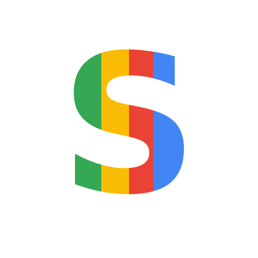

<p align="center">
  
</p>

<h1 align="center">سَنَد الحرمين · Sanad Browser</h1>

<p align="center" dir="rtl"><strong>متصفح سطح مكتب مفتوح المصدر لنظام Windows بواجهة عربية وتبويبات معزولة، مبني على Chromium وElectron.</strong></p>

<p align="center">An Arabic-first, open-source desktop browser for Windows, built on Chromium and Electron.</p>

<p align="center">
  <a href="https://apps.microsoft.com/detail/9NZB8PG7D7KP"><strong>Microsoft Store</strong></a> ·
  <a href="https://ip-murad.com/browser/download/">تحميل Windows</a> ·
  <a href="https://sanadbrowser.com/">الموقع الرسمي</a> ·
  <a href="https://sanadbrowser.com/web/">نسخة الويب</a>
</p>

<p align="center">
  <a href="docs/README.md">دليل المشروع · Project guide</a> ·
  <a href="CONTRIBUTING.md">المساهمة · Contribute</a> ·
  <a href="SECURITY.md">الإبلاغ عن ثغرة · Report a vulnerability</a>
</p>

---

<div dir="rtl" align="right">

## نظرة سريعة

- **التصفح اليومي.** جلسات خاصة مؤقتة، مفضلة وسجل محليان، ووضع قراءة مع تصدير الصفحات إلى PDF أو PNG أو MHTML.
- **الخصوصية.** عزل تبويبات المواقع وفلترة اختيارية للتتبّع والإعلانات. يمكن مراجعة [ضوابط الخصوصية وحدودها](docs/README.md#privacy).
- **الملفات الشخصية والمزامنة.** ملفات محلية منفصلة، ومزامنة انتقائية عبر حساب سَنَد الحرمين، مع خيار مستقل لمزامنة كلمات المرور والبيانات الشخصية. راجع [توثيق الخزنة](docs/profile-vault-system.md) قبل تفعيلها.
- **نطاق المستودع.** يضم تطبيق سطح المكتب ومصدره واختباراته. [نسخة الويب](https://sanadbrowser.com/web/) وخدمات الحساب والبحث تُشغّل بصورة مستقلة.

</div>

## What is included

This repository contains the desktop browser application only. The website, account services, search backend, deployment credentials and historical prototypes are separate. Its initial import includes the browser source, tests and build workflows, without importing private Git history.

- Chromium tabs with sandboxing, context isolation and no Node.js or privileged IPC bridge in remote pages.
- Separate temporary private sessions, local bookmarks and browsing history.
- Reader mode, find in page, PDF/image/MHTML export and bounded, user-directed downloads.
- Optional EasyList/EasyPrivacy filtering and best-effort YouTube ad handling. Blocking every advertisement is not guaranteed.
- Windows MSIX packaging, Store-managed updates, and CI installation tests.

Sanad is an independent project; it is not Google Chrome and is not affiliated with Google. Chromium, Electron and other dependencies retain their own licenses.

## Find your starting point

| If you want to… | Start here |
| --- | --- |
| Install on Windows or open the web companion | [Microsoft Store](https://apps.microsoft.com/detail/9NZB8PG7D7KP) · [Official website](https://sanadbrowser.com/) · [Web companion](https://sanadbrowser.com/web/) |
| Explore the code and its trust boundaries | [Project guide](docs/README.md#repository-map) · [Architecture](desktop/ARCHITECTURE.md) |
| Understand profiles, sync and privacy | [Project guide](docs/README.md#privacy) · [Profile and vault design](docs/profile-vault-system.md) · [Account and sync](desktop/ACCOUNT_SYNC.md) |
| Report a bug, suggest a feature or contribute | [Issue forms](https://github.com/muradaljohani/Sanad-Browser/issues/new/choose) · [Contribution guide](CONTRIBUTING.md) |
| Check builds and security workflows | [Desktop CI](https://github.com/muradaljohani/Sanad-Browser/actions/workflows/desktop.yml) · [Store CI](https://github.com/muradaljohani/Sanad-Browser/actions/workflows/store.yml) · [Security CI](https://github.com/muradaljohani/Sanad-Browser/actions/workflows/security.yml) |

<!-- SANAD_COMMUNITY_INVITATION_START -->
## Join the Sanad Browser Community | انضم إلى مجتمع تطوير سَنَد الحرمين

**ندعو المطورين والمصممين والمختبرين والباحثين الأمنيين ومهتمي المشاريع مفتوحة المصدر من السعودية والعالم للمساهمة في تطوير متصفح سَنَد الحرمين.** نرحب بالمشاركة في Chromium/Electron، تحسين الأداء، الأمان والخصوصية، الواجهات، التعريب، إمكانية الوصول، الاختبارات والتوثيق.

**We invite developers, designers, testers, security researchers and open-source enthusiasts worldwide** to help improve Sanad Browser. Contributions in Chromium/Electron, performance, privacy, security, UI/UX, accessibility, Arabic localization, tests and documentation are welcome.

**[GitHub Organization / المنظمة](https://github.com/SanadBrowser)** · **[Introduce yourself / عرّف بنفسك](https://github.com/muradaljohani/Sanad-Browser/issues/new?template=join-community.yml)** · **[Contributing guide / دليل المساهمة](CONTRIBUTING.md)** · **[Official website / الموقع الرسمي](https://sanadbrowser.com/)**

You can contribute through issues and pull requests without being an organization member. Organization membership requires an invitation from its administrators and is not automatic. / **يمكنك المساهمة دون عضوية المنظمة، والعضوية تُمنح بدعوة من المسؤولين.** Report security vulnerabilities privately as described in [SECURITY.md](SECURITY.md).

<!-- SANAD_COMMUNITY_INVITATION_END -->

## Build and test

Use Node.js 24 and npm. Linux GUI tests require a desktop session or Xvfb; Windows packaging requires Windows.

```sh
git clone https://github.com/muradaljohani/Sanad-Browser.git
cd Sanad-Browser/desktop
npm ci
npm audit --audit-level=moderate
npm test
npm start
```

```sh
# Actual Chromium interaction tests (on Linux with Xvfb)
npm run prepare:filters
xvfb-run -a npm run test:desktop

# Windows packaging on a Windows development machine
npm run dist:win
```

Source builds are development builds. Only the official Microsoft Store installer carries Microsoft's distribution signature. Never install a CI test certificate on an end-user machine or bypass a Windows security warning.

## Security and contributions

Read [SECURITY.md](SECURITY.md), [the security review](docs/security-review-2026-10-28.md), [architecture](desktop/ARCHITECTURE.md), and [contribution instructions](CONTRIBUTING.md). CodeQL, dependency audits, secret scanning and tests provide repeatable checks; passing them does not prove the absence of unknown vulnerabilities.

[Brave architecture review](desktop/BRAVE-RESEARCH.md) · [Desktop documentation](desktop/README.md) · [Store packaging](desktop/STORE.md) · [publisher signing](desktop/SIGNING.md) · [third-party notices](desktop/THIRD_PARTY_NOTICES.md) · [privacy policy](https://ip-murad.com/browser/privacy/)

## License

The application source is [MIT licensed](LICENSE). Third-party libraries and filter lists are covered by their respective notices and licenses. Branding and third-party imagery are not an endorsement or a grant of trademark rights.
